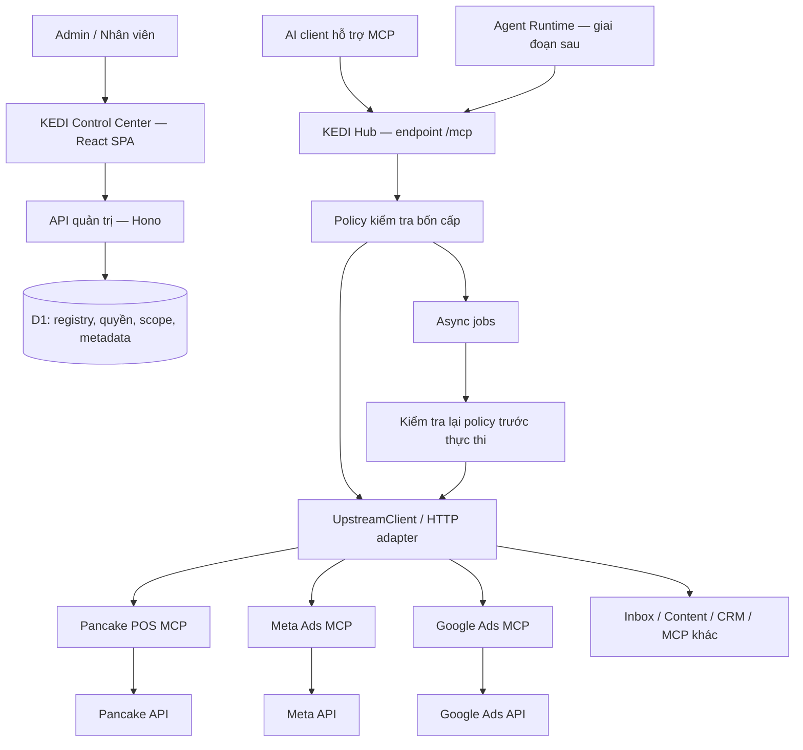

# P — KEDI MCP Hub: kế hoạch kiến trúc và triển khai

Ngày lập: 2026-10-16. Trạng thái: **kế hoạch đề xuất, chưa triển khai**.

Tài liệu này là kế hoạch riêng cho KEDI, không thay thế `docs/PLAN.md`.
Các checkbox biểu thị công việc cần làm; việc có tên file trong cây đề xuất
không có nghĩa file hoặc tính năng đó đã tồn tại.

## 1. Mục tiêu và phạm vi

Xây KEDI MCP Control Center và Gateway trên fork ctxlayer hiện tại để người
quản trị quản lý nhiều MCP độc lập qua một endpoint MCP chung. Phát triển
local trước, sau đó kiểm thử Cloudflare staging và đưa lên production.

Kết quả cần đạt:

- AI client tương thích MCP kết nối một endpoint Hub và chỉ thấy công cụ được cấp.
- Đăng ký MCP chuẩn bằng URL và auth qua Dashboard, không sửa gateway cho từng MCP.
- Quản lý bốn cấp: server, tool/action, connection, tenant/project.
- Tắt hoặc thu hồi quyền có hiệu lực với phiên cũ và job chưa thực thi.
- Từng MCP nghiệp vụ có thể nâng cấp, deploy và rollback độc lập.
- Các thao tác ghi có kiểm soát scope, phê duyệt khi cần và chống thực thi trùng.
- Có nhật ký đủ điều tra lỗi, không ghi token hoặc payload nhạy cảm mặc định.
- Giới hạn lượng tool schema và kết quả gửi cho AI để giảm token.

MVP gồm Hub và một MCP con đã có mã nguồn, ưu tiên Pancake POS với quyền đọc.
Meta Ads, Google Ads, Inbox, Content/CRM, Fufuni, Shipping, Payment và Analytics
là các connector mục tiêu; chưa mặc định có implementation hoặc credentials.
Tự động hóa bằng Agent Runtime triển khai sau khi gateway đạt tiêu chí an toàn.

## 2. Kiến trúc được chọn



Dashboard, API quản trị và gateway tiếp tục thuộc cùng Hub Worker. Session
DO hiện có giữ vai trò quản lý session. Không thêm một gateway bên ngoài
ctxlayer. Các MCP con là repo/service độc lập, có release riêng.

Phân công trách nhiệm:

| Thành phần | Trách nhiệm |
|---|---|
| Hub | Registry, xác thực client, quyền, scope, routing, audit, usage |
| MCP con | Schema nghiệp vụ, API nhà cung cấp, xác thực riêng, kiểm tra ghi dữ liệu |
| Agent Runtime | Nhận sự kiện, chạy workflow có trạng thái, gọi công cụ qua Hub |
| Dashboard | Cấu hình, cấp quyền, ngắt kết nối, theo dõi, phê duyệt |

Hub không chứa SDK nghiệp vụ Meta/Pancake/Google. Agent Runtime không giữ
đường gọi ghi dữ liệu bỏ qua Hub và policy đã thống nhất.

## 3. Đối chiếu nền tảng hiện tại

Đã đối chiếu source local; chưa kiểm chứng tài nguyên hoặc cấu hình tài khoản Cloudflare.

| Hạng mục | Cơ sở hiện có | Phần cần làm |
|---|---|---|
| Registry và enabled | `api/admin-upstreams.ts`, `db/queries/upstreams.ts` | Kiểm tra trạng thái tại thời điểm gọi |
| Proxy và catalog | `mcp/proxy-registry.ts`, `mcp/catalogue-views.ts` | Đồng bộ policy, quản lý thay đổi schema |
| Adapter chung | `upstream/create-client.ts`, `upstream/http-client.ts` | Kiểm thử tương thích từng connector |
| Auth upstream | none, shared_bearer, user_bearer, user_oauth | Rotation và thu hồi credential dùng chung trong phiên cũ |
| ACL tool | Có quyền upstream/tool | Thêm action, scope và kiểm tra quyền mới nhất |
| Credential cá nhân | `mcp/credential-freshness.ts` kiểm tra mỗi lần gọi | Hợp nhất vào authorization gate |
| Async | `mcp/async-submit.ts`, `queues/jobs-consumer.ts` | Kiểm tra lại enabled, quyền và approval trước thực thi |
| Usage/audit | Có pipeline hiện tại | Bổ sung quyết định policy, correlation ID, retention |
| Tenant | `K-multitenancy.md` là kế hoạch exploratory | Chọn deployment riêng cho từng doanh nghiệp |
| R2 | Có binding `DOCS_BUCKET` | Chạy local trước, tạo bucket thật khi lên staging |

Không coi catalog, ACL giữ trong session hoặc dedup async hiện tại là bằng
chứng đã đáp ứng thu hồi quyền và chống ghi trùng ở tầng nghiệp vụ.

## 4. Policy bốn cấp

| Cấp | Khóa/đối tượng | Quyết định cần kiểm tra |
|---|---|---|
| Server | upstream ID, enabled | MCP còn tồn tại, được bật, transport hợp lệ |
| Tool/action | upstream ID + tool + action | Principal được làm đúng thao tác, mặc định từ chối action chưa khai báo |
| Connection | connection ID, chủ sở hữu, credential version | Kết nối hoạt động, credential hợp lệ và đúng phạm vi |
| Tenant/project | deployment identity + project + shop/ad account | Principal, connection và resource thuộc cùng phạm vi được cấp |

Quyền thực thi là giao của cả bốn cấp. Quyền ở cấp dưới không vượt được
lệnh chặn ở cấp trên. Lỗi đọc policy phải từ chối thực thi thay vì cho qua.

Tenant là doanh nghiệp độc lập: chọn một deployment và bộ tài nguyên riêng
cho mỗi tenant, cùng hướng với tài liệu K. Project/shop là phạm vi nghiệp vụ
bên trong tenant. Không coi group hoặc visibility là cách ly tenant đầy đủ.

Scope phải lấy từ identity đã xác thực và mapping phía server. Tham số
`shop_id`, `customer_id`, `ad_account_id` do AI gửi phải được đối chiếu; header
do client tự khai không phải bằng chứng tenant hoặc quyền. Kiểm tra quyền
đối với tài nguyên cụ thể tại MCP con khi chỉ ID tài nguyên chưa đủ xác định scope.

### Hợp đồng authorization đề xuất

`policy/authorize-invocation.ts` nhận principal đã xác thực, project,
connection, upstream, tool, args và operation/approval ID khi có.
Trả quyết định có cấu trúc: allow/deny/approval_required, reason code,
policy version, credential version và scope đã xác minh; không trả secret.

- Dùng chung cho luồng trực tiếp, submit async và queue execution.
- Tái sử dụng truy vấn và schema hiện có; SQL chỉ trong `db/queries/`.
- Ban đầu đọc policy hiện hành ở mỗi lần thực thi. Thiết kế tính nhất quán
  rõ ràng khi đọc từ D1; nếu dùng read replica phải bảo đảm không đọc quyền cũ.
- Chưa thêm cache quyền có TTL làm chậm thu hồi. Chỉ tối ưu khi có đo đạc
  và hợp đồng invalidation/version được kiểm thử.
- Policy không import `api/`, `mcp/`, `queues/`, `collab/`.
- Mỗi tool đa action cần mapping được quản trị, schema kiểm tra được;
  không đoán thao tác nguy hiểm bằng tìm từ trong tên tool.

### Ý nghĩa nút OFF

Sau khi cập nhật OFF được xác nhận, yêu cầu đi qua authorization gate sau
đó phải bị chặn, kể cả session cũ. Queue phải kiểm tra lại ngay trước gửi.
Có khoảng đua giữa kiểm tra và outbound dispatch; không hứa hủy tuyệt đối
lệnh đã được cho phép hoặc đã gửi. Nếu yêu cầu dừng cần tuyến tính hóa,
đánh giá coordinator DO theo connection và ranh giới dispatch ở phase 2.

Lệnh đã gửi có thể đã ghi dữ liệu. Chỉ hủy nếu upstream hỗ trợ; kết quả chưa
rõ phải được đối soát. Dashboard phân biệt blocked, queued, running,
succeeded, failed, unknown; không báo OFF là đã hoàn tác nghiệp vụ.

## 5. Adapter và hợp đồng MCP con

```text
Gateway → createUpstreamClient → UpstreamClient → UpstreamHttpClient → MCP con
```

- Streamable HTTP là lựa chọn mặc định; SSE phục vụ connector cũ tương thích.
- MCP chuẩn dùng adapter chung và cấu hình registry, không thêm code theo thương hiệu.
- stdio cần bridge riêng trên host chạy được process; không spawn process trong Worker.
- API REST cần MCP adapter nghiệp vụ độc lập, ví dụ Meta Ads MCP bọc Meta API.
- Service binding là phương án tối ưu tương lai cho dịch vụ cùng Cloudflare;
  cần implementation và kiểm thử riêng, hiện adapter chủ yếu dùng HTTP.

Checklist onboarding mỗi connector:

- [ ] Có owner, repo, phiên bản, endpoint môi trường và phương thức auth.
- [ ] Initialize, tools/list, tools/call và lỗi tương thích SDK đang ghim.
- [ ] Tool name không xung đột sau namespace; slug theo schema hiện tại (`up-...`).
- [ ] Input schema hợp lệ; phân loại action đọc/ghi và mapping scope.
- [ ] Có timeout, pagination, hạn mức kết quả và cách xử lý 429.
- [ ] URL, redirect và OAuth endpoint vượt kiểm tra SSRF/trust boundary hiện có.
- [ ] Không cho client tự chọn endpoint outbound hoặc chèn Authorization.
- [ ] Không echo secret/lỗi nhạy cảm; metadata và kết quả upstream là dữ liệu không tin cậy.
- [ ] So sánh catalog trước/sau nâng cấp; tool mới chưa được duyệt không tự có quyền ghi.
- [ ] Ghi rõ chỉ hỗ trợ tools hay cả resources/prompts; không mặc định proxy mọi capability MCP.

## 6. Workflow

### 6.1 Đăng ký và công bố MCP

```text
Admin tạo upstream ở trạng thái Disabled
→ kiểm tra URL/auth/ownership
→ lưu credential đã mã hóa
→ kiểm tra kết nối và lấy catalog có giới hạn
→ xem schema diff, phân loại action và scope
→ gán quyền/project/connection
→ chạy smoke read-only
→ bật upstream
→ reload catalog/session khi cần để client nhận tool mới
```

Reload tool phục vụ discoverability; quyền thực thi không phụ thuộc việc
client đã reload. Kiểm tra cả session mới và session cũ.

### 6.2 Gọi tool trực tiếp

```text
Xác thực client → resolve principal/project/connection
→ validate tool args → authorize bốn cấp
→ kiểm tra approval và operation ID nếu là thao tác ghi
→ lấy credential đúng version → gọi MCP con
→ MCP con kiểm tra nghiệp vụ và quyền tài nguyên
→ chuẩn hóa kết quả → audit/usage → trả client
```

Token theo ba tầng độc lập: client→Hub, Hub→MCP con, MCP con→API nhà cung cấp.
Không passthrough token đăng nhập Hub. Endpoint MCP con có auth bắt buộc
trên môi trường thật; đặc biệt cấu hình `MCP_AUTH_TOKEN` cho Pancake Worker.

### 6.3 Job bất đồng bộ

```text
Authorize lúc submit → tạo operation/job → enqueue ID tham chiếu
→ consumer đọc job và policy hiện hành
→ kiểm tra lại bốn cấp + approval + trạng thái operation
→ nhận execution lease nguyên tử → gọi upstream
→ lưu kết quả → ack → client poll theo quyền hiện hành
```

Message chứa ID tham chiếu và dữ liệu tối thiểu, không chứa bearer đã giải mã.
Consumer xác minh nội dung message khớp job persisted; không tin args/principal
trong message như nguồn thẩm quyền. Poll hoặc replay kết quả cũng kiểm tra scope
và quyền hiện hành để không lộ dữ liệu sau thu hồi quyền.

Permanent deny/revoked/invalid args chuyển terminal và ack. Lỗi hạ tầng
transient mới retry có giới hạn; hết lượt đưa DLQ hoặc cơ chế cảnh báo tương đương.
Không tự động retry thao tác ghi có kết quả chưa xác định.

### 6.4 Phê duyệt và chống ghi trùng

```text
Yêu cầu ghi → policy yêu cầu duyệt → lưu đề nghị + canonical args hash
→ người có quyền duyệt xem đúng tham số và phạm vi
→ approve có hạn dùng → kiểm tra lại policy
→ claim approval/operation nguyên tử → thực thi → lưu kết quả
```

Approval gắn principal, connection, project/resource, tool/action, hash của
tham số, policy version, expiry và operation ID. Sửa tham số phải duyệt lại.
Không dùng lời khẳng định của AI làm chứng cứ đã được duyệt.

Idempotency dùng operation ID do workflow/client quản lý, có unique constraint
theo phạm vi; cùng tham số nhưng operation khác có thể là yêu cầu hợp lệ mới.
Truyền idempotency key tới provider nếu hỗ trợ. Nếu provider không hỗ trợ và
timeout sau khi gửi: đánh dấu unknown, đối soát hoặc yêu cầu người xử lý.
Execution lease chỉ chặn chạy đồng thời; không bảo đảm exactly-once ở API ngoài.

### 6.5 Thu hồi và rotation

Admin OFF/khóa action/ngắt connection → persist thay đổi + tăng version
→ ghi audit → invocation gate chặn lệnh tiếp theo → job chờ bị chặn.
Credential rotation tăng version và buộc bind lại client dùng credential cũ.
Thu hồi local không đồng nghĩa thu hồi token tại nhà cung cấp; có thao tác
riêng khi provider hỗ trợ, với trạng thái và kết quả được ghi nhận.

## 7. Cấu trúc folder triển khai

`[có]` là module đã tồn tại; `[mới]` là đề xuất. Các module không liên quan
được lược bớt; không di chuyển hoặc đổi tên source hiện tại chỉ để giống cây này.

```text
D:/monorepo-project-workspace/
├── ctxlayer/                                  # Repo Hub, deploy độc lập
│   ├── apps/worker/
│   │   ├── src/
│   │   │   ├── index.ts                       # [có] route /mcp và API
│   │   │   ├── env.ts                         # [có] typed Env
│   │   │   ├── api/
│   │   │   │   ├── admin-upstreams.ts         # [có]
│   │   │   │   ├── upstreams.ts               # [có]
│   │   │   │   ├── admin-projects.ts          # [mới]
│   │   │   │   ├── admin-policies.ts          # [mới]
│   │   │   │   └── approvals.ts               # [mới]
│   │   │   ├── mcp/
│   │   │   │   ├── session-do.ts              # [có]
│   │   │   │   ├── proxy-registry.ts          # [có] gọi policy gate
│   │   │   │   ├── catalogue-views.ts         # [có]
│   │   │   │   ├── upstream-call-runner.ts    # [có]
│   │   │   │   └── async-submit.ts            # [có] kiểm tra submit
│   │   │   ├── policy/                       # [mới] độc lập transport
│   │   │   │   ├── authorize-invocation.ts
│   │   │   │   ├── server-access.ts
│   │   │   │   ├── tool-action-access.ts
│   │   │   │   ├── connection-access.ts
│   │   │   │   ├── project-scope.ts
│   │   │   │   └── approval.ts
│   │   │   ├── operations/                   # [mới] trạng thái thao tác ghi
│   │   │   │   ├── execute-once.ts
│   │   │   │   └── reconcile.ts
│   │   │   ├── upstream/                     # [có] adapter transport chung
│   │   │   │   ├── upstream-client.ts
│   │   │   │   ├── create-client.ts
│   │   │   │   └── http-client.ts
│   │   │   ├── queues/jobs-consumer.ts        # [có] kiểm tra lại policy
│   │   │   ├── db/
│   │   │   │   ├── migrations/               # [có] thêm migration mới
│   │   │   │   └── queries/
│   │   │   │       ├── upstreams.ts           # [có]
│   │   │   │       ├── projects.ts            # [mới]
│   │   │   │       ├── invocation-policies.ts # [mới]
│   │   │   │       ├── approvals.ts           # [mới]
│   │   │   │       └── operations.ts          # [mới]
│   │   │   ├── auth/                         # [có]
│   │   │   ├── audit/                        # [có]
│   │   │   └── usage/                        # [có]
│   │   └── test/integration/                 # [có] thêm bộ test KEDI
│   ├── apps/web/src/
│   │   ├── routes/                           # [có] mở rộng trang quản trị
│   │   ├── components/                       # [có] đặt theo concern thực tế
│   │   └── lib/api/                          # [có] typed fetch helpers
│   ├── packages/shared/src/                  # [có] schema/types dùng chung
│   ├── scripts/                              # [có] verify/build/deploy
│   ├── docs/plan/P-kedi-mcp-hub.md            # Tài liệu này
│   ├── wrangler.toml                         # [có] giữ convention TOML
│   └── package.json                          # [có]
├── pancake-pos-mcp/                           # Repo có sẵn; giữ layout
├── kedi-meta-ads-mcp/                         # Repo tương lai
│   ├── src/{index.ts,tools/,meta/,auth/,schemas/}
│   ├── test/
│   ├── wrangler.toml
│   └── package.json
├── kedi-google-ads-mcp/                       # Repo tương lai, layout tương tự
├── kedi-content-crm-mcp/                      # Chỉ tạo khi triển khai
└── kedi-agent-runtime/                       # Giai đoạn tự động hóa
    ├── src/{index.ts,events/,workflows/,gateway-client/}
    ├── test/
    └── wrangler.toml
```

Các tên module mới có thể điều chỉnh khi thiết kế chi tiết để tái sử dụng
code sẵn có. Không tạo repository con, scaffolding hoặc abstraction chưa dùng
chỉ để lấp đầy cây thư mục. Mỗi file một concern; không giới hạn cứng số dòng.

## 8. Mô hình dữ liệu cần thiết kế

Tận dụng upstream_servers, credential, tool-access và async_jobs đang có.
Trước khi thêm bảng, kiểm tra migrations hiện hành để tránh mô hình trùng.

| Khái niệm đề xuất | Dữ liệu và ràng buộc |
|---|---|
| Project | ID, tên, active, membership; thuộc deployment tenant |
| Connection scope | Mapping upstream/credential owner → project → resource allowlist; version |
| Action policy | upstream/tool/action, principal/role, allow/deny/approval, version |
| Approval | Người đề nghị/duyệt, operation ID, canonical args hash, scope, expiry, trạng thái |
| Operation | ID, scope, request hash, state, lease, provider reference, kết quả/unknown |

Credential tiếp tục lưu theo cơ chế mã hóa hiện có; không sao chép secret
vào bảng scope. Thiết kế unique/FK/index và CHECK cho state enums. Claim
approval/operation dùng conditional write hoặc transaction phù hợp D1,
không dựa vào cặp read-then-write dễ bị đua.

## 9. Local → staging → production

### Local

- [ ] Kiểm tra `bun.lock`, cài `bun install --frozen-lockfile`.
- [ ] Chuẩn bị `.dev.vars` theo cấu hình repo; không in hoặc commit secret.
- [ ] Dùng hook dev TLS, ensure-dist và migration local hiện có.
- [ ] Chạy `bun run dev`; MCP con ở cổng riêng, đăng ký URL loopback hợp lệ.
- [ ] D1/R2/KV/DO/Queues dùng mô phỏng local phù hợp Wrangler đang ghim.
- [ ] Xác minh không có remote binding ngoài ý muốn trước test mutation.
- [ ] Test policy với fake upstream có bộ đếm call, không ghi vào shop thật.
- [ ] RAG/Workers AI/Vectorize mock trong test hoặc kiểm chứng riêng trên staging.

Không cần tạo bucket R2 thật để bắt đầu local. `DOCS_BUCKET` giữ nguyên API
binding. R2 dành cho docs/artifact; registry, quyền và operation metadata ở D1.
Không bỏ binding hoặc tắt module RAG bằng giả định khi code vẫn tham chiếu.

### Staging

- [ ] Tạo Worker và bộ D1/KV/R2/Queues/Vectorize cần thiết riêng với production.
- [ ] Kiểm kê binding thực tế trong `wrangler.toml`, bao gồm queue jobs;
      không sao chép nguyên script ví dụ cũ nếu thiếu tài nguyên hiện tại.
- [ ] Bổ sung cấu hình staging và đường deploy rõ ràng; kiểm tra script
      deploy hiện đọc `.prod.vars` để tránh vô tình lấy origin production.
- [ ] Cấu hình IdP callback, secrets, encryption key và origin của staging.
- [ ] Áp dụng migration lên staging, seed dữ liệu giả và credential sandbox.
- [ ] Chạy smoke qua HTTPS, OAuth, MCP và async job thực tế.

Upload version/preview không mặc nhiên cách ly database hoặc bucket. Phải
kiểm chứng mapping tài nguyên trước bất kỳ thao tác ghi nào.

### Production

- [ ] Xác nhận domain sở hữu; `https://mcp.kedi.media/mcp` chỉ là URL dự kiến.
- [ ] Kiểm tra allowlist/admin, auth MCP con bắt buộc, credential scope tối thiểu.
- [ ] Tạo tài nguyên riêng, backup và lưu khóa mã hóa trong secret store.
- [ ] Chạy migration tương thích ngược, deploy release đã kiểm thử.
- [ ] Canary read-only, mở quyền ghi theo nhóm nhỏ sau nghiệm thu.
- [ ] Có rollback code, phương án migration và đối soát job đang chạy.

Dữ liệu local không tự được upload khi deploy. Chỉ chuyển dữ liệu đã chọn
bằng migration/seed/import riêng. Rollback Worker không rollback D1/R2.

## 10. Các phase và tiêu chí hoàn thành

Thực hiện tuần tự theo gate. Chỉ đánh dấu hoàn thành khi có kết quả kiểm thử;
không đánh dấu phase xong vì đã tạo folder hoặc Dashboard hiển thị nút.

### Phase 0 — Baseline và thiết kế hợp đồng

Mục tiêu: thống nhất phạm vi MVP, môi trường và ranh giới bảo mật.

- [ ] Chốt một tenant, danh sách project/shop và principal thử nghiệm.
- [ ] Chọn MCP đầu tiên có source/credentials; mặc định Pancake POS read-only.
- [ ] Lập bảng endpoint/auth/capability/action/resource cho connector đó.
- [ ] Kiểm kê SDK ghim, bindings và test baseline bằng `bun run verify`.
- [ ] Xác định consistency, thu hồi quyền, unknown outcome và ownership dữ liệu.

Đầu ra: hợp đồng connector, ma trận quyền và inventory hạ tầng trong PR triển khai.
Gate: mọi thao tác ghi vẫn bị chặn; không cần tài nguyên Cloudflare thật.

### Phase 1 — Hub local và một connector chỉ đọc

Mục tiêu: luồng Dashboard → registry → MCP client → MCP con hoạt động local.

- [ ] Hoàn thiện cấu hình dev, seed local và fake upstream kiểm thử.
- [ ] Đăng ký connector Disabled, cấu hình bearer/OAuth phù hợp.
- [ ] Refresh catalog, namespace, kiểm tra schema rồi cấp tool đọc.
- [ ] Kiểm tra list/get, lỗi auth, timeout và upstream không truy cập được.
- [ ] Xác minh Dashboard phân biệt enabled, connected và healthy.

Đầu ra: bản demo local đọc dữ liệu qua Hub và log có correlation ID.
Gate: không có truy cập ghi ngoài ý muốn; lỗi một MCP không làm Hub sập.

### Phase 2 — Authorization bốn cấp và kill switch

Mục tiêu: quyền được cưỡng chế khi thực thi, có project scope từ MVP.

- [ ] Thêm mapping project/connection/resource và action policy tối thiểu.
- [ ] Tích hợp authorize gate vào direct, async submit, queue và đọc kết quả.
- [ ] Kiểm tra enabled/quyền/principal hiện hành và credential version.
- [ ] Làm rõ ranh giới OFF/dispatch; triển khai coordinator nếu hợp đồng cần.
- [ ] Cập nhật Dashboard cho bốn cấp và lý do bị chặn.
- [ ] Kiểm thử OFF, ACL revoke, ngắt credential/rotation trong session cũ.
- [ ] Kiểm thử cross-project và tài nguyên giả mạo, mặc định deny action lạ.

Đầu ra: ma trận quyền thực thi và test regression cho direct/queue.
Gate: yêu cầu bị chặn không chạm upstream; queue chờ không vượt quyền mới.

### Phase 3 — Ghi dữ liệu, approval và idempotency

Mục tiêu: mở một thao tác ghi ít rủi ro với khả năng đối soát.

- [ ] Thiết kế state machine operation và approval cùng migration.
- [ ] Thêm API/UI đề nghị, duyệt, từ chối, hết hạn và audit.
- [ ] Bind approval vào đúng args/scope/version; claim nguyên tử.
- [ ] Chặn replay đồng thời; phân biệt retry cùng operation và yêu cầu mới.
- [ ] Xử lý timeout sau dispatch thành unknown khi không thể xác minh kết quả.
- [ ] Thử nghiệm fault injection: provider thành công nhưng lưu kết quả thất bại.

Đầu ra: một action ghi có đường duyệt/ghi/đối soát xuyên suốt.
Gate: không tuyên bố exactly-once nếu provider không hỗ trợ; không blind retry.

### Phase 4 — Connector thứ hai và quản lý catalog

Mục tiêu: chứng minh Hub không phụ thuộc nghiệp vụ của MCP đầu tiên.

- [ ] Nối MCP thứ hai qua registry; chọn Meta/Google Ads hoặc MCP sẵn có.
- [ ] Không sửa routing gateway chỉ để thêm MCP chuẩn.
- [ ] Thêm contract tests, catalog diff và mapping action/scope riêng.
- [ ] Kiểm thử tên tool trùng, schema đổi, auth hết hạn và upstream lỗi.
- [ ] Giới hạn retry, timeout/concurrency theo connection và tenant.

Đầu ra: hai MCP hoạt động độc lập sau cùng endpoint Hub.
Gate: nâng cấp/tắt một MCP không làm hỏng kết nối còn lại.

### Phase 5 — Cloudflare staging và vận hành

Mục tiêu: kiểm chứng điều local không đại diện đầy đủ.

- [ ] Provision tài nguyên staging thật, bao gồm R2, cấu hình origin/secrets.
- [ ] Verify offline trước push; build và smoke trên staging.
- [ ] Test ít nhất một client mục tiêu thực tế, OAuth và session reconnect.
- [ ] Test queue redelivery, policy revoke, restart và credential rotation.
- [ ] Thiết lập metrics, cảnh báo, retention, quota và quy trình khôi phục.
- [ ] Kiểm tra catalog size/token budget và thời gian initialize.

Đầu ra: URL staging và báo cáo nghiệm thu có evidence, không chứa secret.
Gate: đạt checklist mục 11; dữ liệu staging cách ly production.

### Phase 6 — Production và release độc lập

Mục tiêu: phát hành Hub cùng connector đã qua staging.

- [ ] Domain, callback, tài nguyên, secrets, backup và quyền admin sẵn sàng.
- [ ] Deploy Hub/connector theo phiên bản tương thích đã kiểm thử.
- [ ] Canary read-only, sau đó mở action ghi đã được duyệt.
- [ ] Thực hành tắt khẩn cấp, rollback code và đối soát operation unknown.
- [ ] Chỉ định owner Hub và owner từng connector.

Đầu ra: endpoint production quản trị được từ Dashboard và runbook vận hành.
Gate: không có blocker quyền/scope/ghi trùng; quan sát được lỗi và có người xử lý.

### Phase 7 — Agent Runtime và mở rộng doanh nghiệp

Mục tiêu: tự động hóa trên nền Hub đã ổn định; không thuộc MVP gateway.

- [ ] Event receiver xác minh chữ ký, chống sự kiện trùng rồi enqueue.
- [ ] Workflow có trạng thái, operation ID và principal dịch vụ tối thiểu quyền.
- [ ] Gọi tool qua Hub, dùng approval chung, có pause/cancel và đối soát.
- [ ] Thêm Inbox/Shipping/Content/Payment theo nhu cầu đã xác nhận.
- [ ] Doanh nghiệp mới dùng deployment và tài nguyên riêng theo hướng K.

Đầu ra: một workflow nghiệp vụ hoàn chỉnh, ví dụ inbox → đề nghị tạo đơn → duyệt → tạo đơn.
Gate: không mở rộng quyền chỉ vì workflow chạy tự động; kiểm thử cách ly doanh nghiệp.

## 11. Checklist nghiệm thu và bằng chứng

| Tình huống | Kết quả bắt buộc |
|---|---|
| Không xác thực / token sai đối tượng | Không truy cập tool hoặc kết quả |
| Server OFF, session cũ | Invocation mới bị chặn, upstream call count không tăng |
| Queue đang chờ rồi server OFF | Terminal blocked, không outbound call |
| Thu hồi tool/action/role | Quyền mới có hiệu lực, không dựa vào catalog cũ |
| Thu hồi credential cá nhân hoặc shared | Client cũ không tiếp tục dùng secret đã thu hồi |
| Rotation credential | Bind lại đúng version, không lộ credential |
| Giả mạo shop/ad account/project | Deny trước outbound hoặc trước ghi tại MCP con |
| Poll/replay sau mất quyền | Không đọc lại kết quả thuộc phạm vi đã thu hồi |
| Approval sửa args, hết hạn hoặc dùng lại | Không thực thi |
| Hai worker nhận cùng operation | Chỉ một bên nhận quyền thực thi |
| Timeout sau provider write | Unknown/đối soát; không tự tạo bản ghi thứ hai |
| MCP thứ hai thêm bằng Dashboard | Không cần sửa mã routing gateway |
| Một MCP 429/timeout/schema lỗi | MCP khác vẫn dùng được; retry được giới hạn |
| Upstream text chứa control chars/secret lỗi | Sanitization/redaction theo quy ước hiện có |
| Kết quả quá lớn | Giới hạn rõ ràng, có pagination; không mất trạng thái ghi quan trọng |
| Staging deploy | Không đọc/ghi nhầm D1/R2/queue production |

Mỗi mục cần test name hoặc bằng chứng smoke cùng revision và môi trường.
Không dùng một ảnh Dashboard làm bằng chứng cho enforcement ở backend.

## 12. Quan sát, hiệu năng và token

- Log quyết định policy với correlation ID, principal ID, project/connection,
  tool/action, reason code, policy version; tránh payload khách hàng mặc định.
- Đo tỷ lệ lỗi, p95 latency theo connector, thời gian initialize, queue age,
  blocked calls, unknown operations, credential expiry và catalog drift.
- Tách usage analytics best-effort khỏi audit của thao tác ghi: không làm mất
  quyết định/operation quan trọng chỉ vì queue usage lỗi. Đánh giá outbox cho audit.
- Đặt retention theo loại dữ liệu và quy trình xóa/backup; không lưu vô hạn.
- Tool list theo vai trò/project; mô tả ngắn, pagination, fields và date range.
- Với catalog lớn, đánh giá search/describe/execute sau đo đạc, không bỏ schema
  validation hoặc authorization để giảm token.
- RTK dùng cho CLI của người phát triển (`rtk rg`, `rtk read`, `rtk err bun run verify`);
  không lọc JSON nghiệp vụ trong runtime MCP bằng RTK.
- Ghi baseline tool count, schema bytes/token ước tính, result bytes và cold
  initialize latency; chốt ngưỡng chấp nhận sau phase 1 thay vì hứa tỷ lệ tiết kiệm.

## 13. Quy trình PR, kiểm thử và bảo trì

Mỗi phase có thể chia thành nhiều PR nhỏ theo concern: migration/schema →
backend enforcement → Dashboard → integration. Không tạo một PR khổng lồ
gộp Hub, tất cả MCP và Agent Runtime.

- [ ] Schema API ở shared và typed helper web dùng cùng schema.
- [ ] Route mutation có CSRF; admin route có requireAdmin.
- [ ] Typed Env; SQL trong queries; không circular dependency các concern.
- [ ] Test hành vi chính, gồm deny và concurrency; không chỉ test hình dạng helper.
- [ ] Chạy `bun run verify` trước commit/push; có thể dùng RTK bọc để giảm output.
- [ ] Với thay đổi runtime, chạy smoke khi Worker local/staging đang hoạt động.
- [ ] Commit nêu lý do, push nhánh `codex/…`, mở PR kèm validation.
- [ ] Kiểm tra compatibility matrix trước nâng SDK hoặc connector schema.
- [ ] Đồng bộ upstream ctxlayer qua PR riêng; giữ customization KEDI tập trung.

Không nâng SDK/transport lớn cùng PR policy. Source hiện ghim MCP SDK v1 và
Agents SDK; tài liệu Cloudflare mới hướng stateless server sang handler mới.
Đánh giá migration riêng dựa trên session/progress/replay hiện có và test tương thích.

## 14. Nguồn tham chiếu và quyết định còn mở

Source chính: `AGENTS.md`, `wrangler.toml`, `apps/worker/package.json`,
`apps/worker/src/mcp/`, `apps/worker/src/upstream/`, `apps/worker/src/queues/jobs-consumer.ts`.
Tài liệu liên quan: [C — upstream proxy](C-upstream-proxy.md),
[I — resilience](I-upstream-resilience.md), [K — tenant deployment](K-multitenancy.md),
[E — dev environment](E-dev-environment.md).

Tham chiếu nền tảng, cần kiểm tra lại trước khi triển khai API/config mới:

- [Cloudflare remote MCP](https://developers.cloudflare.com/agents/model-context-protocol/guides/remote-mcp-server/).
- [R2 Workers API và local development](https://developers.cloudflare.com/r2/api/workers/workers-api-usage/).
- [Local data](https://developers.cloudflare.com/workers/local-development/local-data/).
- [MCP security best practices](https://modelcontextprotocol.io/docs/2025-11-25/tutorials/security/security_best_practices).

Các lựa chọn cần chốt ở phase tương ứng, không chặn viết plan hoặc dev read-only:

1. Tenant/project đầu tiên, shop và MCP có credential sandbox để thử.
2. Client mục tiêu và cách auth thực tế; tên model không tự chứng minh client hỗ trợ MCP.
3. Action nào cần approval, ai duyệt, hạn mức và thời hạn.
4. Provider hỗ trợ idempotency/đối soát đến đâu.
5. Domain thực tế, account Cloudflare và resource staging/production.
6. SLO, quota, retention và thời hạn khôi phục dựa trên nhu cầu vận hành.
